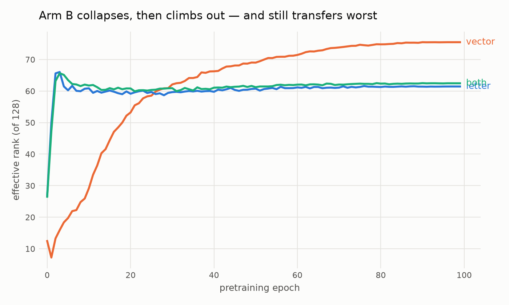
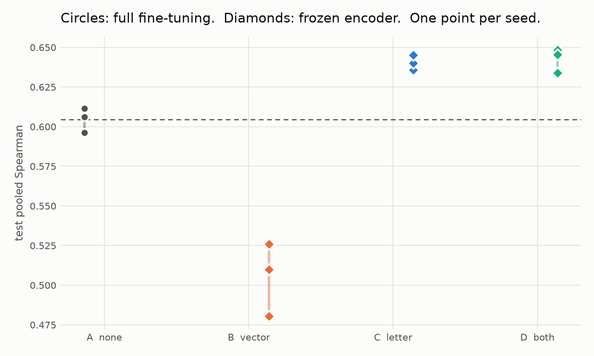

# Does it matter what you predict?

**Latent vs masked-residue pretraining for protein stability.**

A graph network can learn about proteins without any lab measurements, by hiding part of a
structure and guessing what was there. This repository asks what the guess should be:

- **the letter** — which of the 20 amino acids was hidden, or
- **the vector** — what embedding a slowly updated copy of the network would give that
  position (a JEPA objective), or
- **both.**

Everything else is held fixed — the same graph, encoder, corpus, masking rate, optimiser
and seeds — so any difference comes from the pretraining target alone. Each pretrained
model is then used to predict how much a single mutation destabilises a protein (ΔΔG).

**Authors:** Fidan Karimli and Pau Martínez. Started at the Petnica Summer Institute
(Scientific Machine Learning, August 2026); this is the follow-up experiment.

[](https://www.python.org/)
[](LICENSE)

---

## Results

Three seeds per arm, 11,566 SCOPe domains for pretraining, MegaScale for the task, on one
A100. Arms B, C and D fine-tune a **frozen** encoder; arm A has nothing to freeze, so it
trains everything.

| Arm | Pretraining target | Pooled Spearman | Per-protein median | RMSE | Effective rank |
|---|---|---|---|---|---|
| A | none | 0.605 ± 0.008 | 0.643 ± 0.011 | 0.802 ± 0.011 | — |
| B | vector | **0.506 ± 0.023** | 0.539 ± 0.018 | 0.903 ± 0.015 | **74.2 ± 2.3** |
| C | letter | 0.640 ± 0.005 | 0.688 ± 0.005 | 0.767 ± 0.006 | 61.9 ± 0.5 |
| D | letter + 0.45 × vector | **0.643 ± 0.008** | **0.692 ± 0.010** | 0.768 ± 0.005 | 62.6 ± 0.3 |

A difference under 0.012 pooled, or 0.016 per-protein, is a tie. That threshold is two
standard deviations of arm A across seeds, and it was fixed **before** any pretrained arm
was run.

### What we found

**1. Pretraining helps, but only with the right target.** Letter pretraining beats the
baseline by 0.035, with a *frozen* encoder that never saw a single stability measurement,
against a baseline that trained its whole network on 215,000 labelled mutations.

**2. The wrong target actively hurts.** Vector-only pretraining lands 0.099 *below* random
initialisation. Unfrozen, under exactly the baseline's protocol, it is still below it. The
encoder is a worse starting point than no pretraining at all, and training only partly
undoes the damage.

**3. The standard diagnostic points the wrong way.** Effective rank — the RankMe quantity,
widely used as a label-free proxy for representation quality — ranks the arms in exactly
the reverse of how they transfer. Arm B spreads across 74 of 128 dimensions and performs
worst; arm C uses 62 and performs best.



Arm B's curve explains a puzzle the earlier project recorded but could not account for: its
JEPA loss rose during training. At epoch 1 the model **collapses** — every residue maps to
nearly the same vector, and the loss falls to 0.007 because predicting a constant is
trivial (rank 7.7). Then the EMA teacher makes that constant unstable, the representation
spreads back out, and the task gets genuinely harder, so **the loss rises as the model
escapes collapse**. With a moving target, a falling loss is not evidence of progress.

And escaping collapse is not the same as learning something useful.

**4. A harmful objective becomes harmless in company.** Alone, the vector loss costs 0.099.
Added alongside the letter loss at λ = 0.45 it costs nothing — arm D ties arm C — and it
prevents the collapse entirely: at epoch 1 arm D's rank was 47.3, not 7.7.

**5. The vector arm is also unstable.** Its seed spread is ±0.023 against arm C's ±0.005.



Reference points, not targets: ThermoMPNN reports 0.725 on this test set with far heavier
pretraining, and 0.642 from scratch.

---

## How it works

**The task.** MegaScale (Tsuboyama et al. 2023) measured the stability of every
single-residue mutant of hundreds of small protein domains: 271,231 measurements across 298
proteins, split train/validation/test **by protein** at 25% sequence identity, so no test
protein resembles anything seen in training.

**The graph.** One node per residue at its Cα atom, joined to its 16 nearest neighbours in
3D. 62.5% of edges join residues more than 4 apart in the chain — contacts created by
folding, which a sequence model cannot see. Node features are backbone torsions, edge
features are distances and sequence separation.

**The leak rule.** No input feature may reveal which amino acid a residue is, or the letter
arm could read the answer instead of predicting it. Only backbone atoms are used, never
side chains. `tests/test_graph.py` enforces this by relabelling a residue and requiring
every geometric feature to be bit-identical.

**The encoder.** Four GINEConv layers, 128 dimensions. Residue identity and backbone
geometry are embedded separately and added, so masking replaces only the identity and the
geometry stays visible.

**Pretraining.** 20% of residues are replaced by a learned mask token. Arm C predicts their
letters, arm B predicts an EMA teacher's embedding of them from the unmasked graph, arm D
does both.

**Fine-tuning.** One batch item is one protein carrying all of its mutations, so 215,000
training examples cost 239 encoder passes per epoch.

---

## Reproducing it

```bash
python -m venv .venv && source .venv/bin/activate
pip install torch                       # or the CUDA build your driver supports
pip install torch_geometric pandas scipy scikit-learn matplotlib pyyaml tqdm pytest tabulate
pip install -e .

bash scripts/download_megascale.sh      # 90 MB, labels and splits
bash scripts/download_structures.sh     # 13 MB, wild-type structures
bash scripts/download_scope.sh          # 1 GB, pretraining corpus

pytest tests/ -q                        # 45 tests: data alignment, leak rule, EMA, metrics

bash scripts/run_grid.sh                # 4 arms x 3 seeds, ~2 h on an A100
python scripts/make_report.py           # tables and figures
```

`data/processed/pretrain_ids.txt` lists exactly which 11,566 SCOPe domains were used, so
the corpus is reproducible without re-running the similarity filter. Rebuilding it needs
MMseqs2 and `scripts/build_pretrain_set.py`.

Individual runs:

```bash
python -m pobj.train.pretrain --config configs/arm_c.yaml --seed 0
python -m pobj.train.finetune --config configs/arm_c.yaml --seed 0
```

### Layout

```
src/pobj/
  data/      megascale.py  graph.py  features.py  masking.py  pretrain_set.py  dataset.py
  models/    encoder.py  heads.py  ema.py
  eval/      metrics.py  rank.py
  train/     pretrain.py  finetune.py
configs/     base.yaml + one file per arm
scripts/     downloads, the grid runner, the report
results/     runs.csv, per-epoch logs, figures
docs/        progress.md, the full record of what we did and found
```

---

## Leakage, and why we were strict about it

Any pretraining structure resembling a MegaScale protein could let the model meet a test
protein before evaluation. We search all pretraining sequences against the 298 MegaScale
proteins with MMseqs2 at its most sensitive setting and remove **every** hit at
e-value ≤ 1e-3 — not only those above 30% identity, because remote homologues can share a
fold. That removed 225 of 11,791 SCOPe domains, of which 218 were already above 30%
identity, so the stricter rule cost 7 extra domains. The removed list is kept in
`data/processed/removed_similar.txt`.

## Limits

- **28 test proteins.** Small, and the per-protein median over so few is noisy.
- One encoder, one stability dataset, one pretraining corpus, three seeds. This is a
  controlled small experiment, not a ranking of methods in general.
- Effective rank is measured on held-out **pretraining** residues, so it describes the
  space the model trained in rather than the one it transfers to.
- Pretraining domains have a median of 126 residues against MegaScale's 48.
- Not yet tried: a λ sweep, label-efficiency curves, a frozen random encoder, longer
  pretraining (arm B's rank was still rising at epoch 99), and linear probes to say *what*
  the letter arm learned that the vector arm did not.

## Credits

Thanks to our mentor and the Petnica team for the course this grew out of:
<https://github.com/zenwor/sciml26_gjepa>. Our team repo from the course:
<https://github.com/paumartinez160/sciml26_gjepa>.

Building on: Tsuboyama et al. 2023 (MegaScale), Dieckhaus et al. 2024 (ThermoMPNN),
Ofer et al. 2026 (ProteinJEPA), Jamasb et al. 2024 (ProteinWorkshop), Garrido et al. 2023
(RankMe), Assran et al. 2023 (I-JEPA), Hu et al. 2020 (GINE).

## License

MIT, see [LICENSE](LICENSE).
