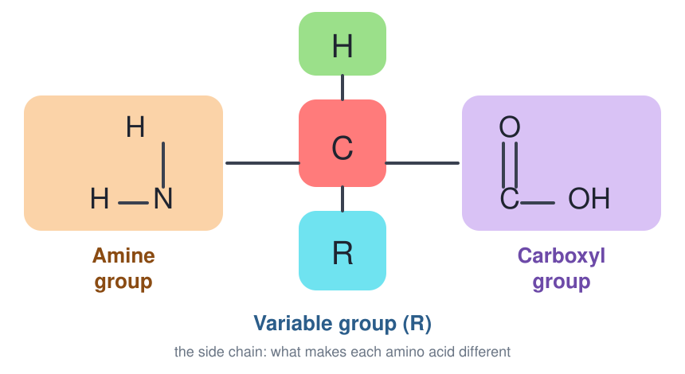
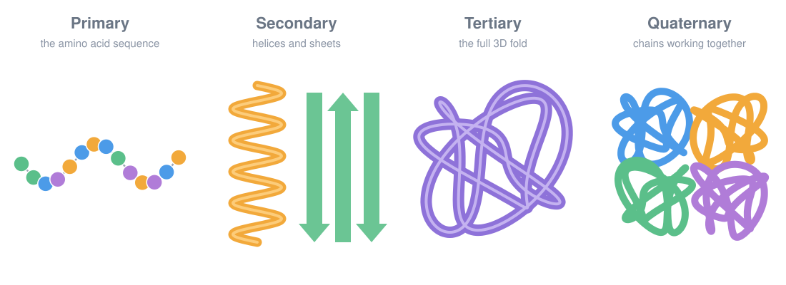
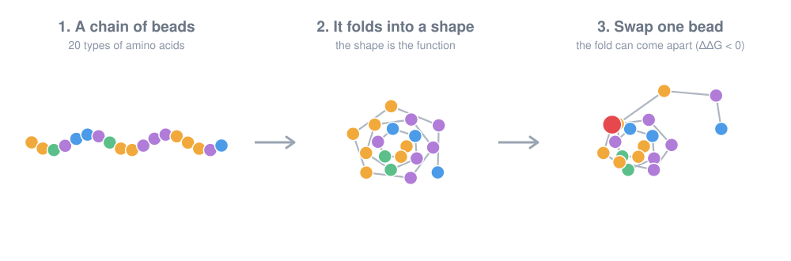

# Graph-JEPA for Protein Stability Prediction

We started this project at the Petnica Summer Institute (Scientific Machine Learning, August 2026),
and we liked it enough that we wanted to keep going. This repo is where we do that.

**Authors:** Fidan Karimli and Pau Martínez

[](https://canva.link/7dgujdjexcuhrbe)
[](https://www.python.org/)
[](LICENSE)

## A short guide to proteins

Proteins are the molecular machines of life. They speed up reactions, carry molecules around,
pass signals and build the scaffolding of our cells. For machine learning they are special:
a protein is a biological object and structured data at the same time. It can be a sequence,
a set of 3D coordinates or, in this project, a graph.

### 1. Amino acids: the building blocks

Every amino acid shares the same backbone, a central carbon with an amine group on one side
and a carboxyl group on the other. What changes is the **side chain** (the R group). Some
side chains repel water, some are charged, some are bulky and some are tiny, and this variety
decides how a chain folds and how the finished protein behaves.



### 2. From sequence to shape

Link amino acids together and you get a chain, like a necklace of beads with 20 possible bead
types. But the chain doesn't stay straight. It crumples into one precise 3D shape, and that
shape is what lets an enzyme grip its target or an antibody recognize a virus. Biologists
describe this in four levels:



- **Primary:** the sequence of amino acids
- **Secondary:** local patterns such as helices and sheets
- **Tertiary:** the full 3D arrangement of one chain
- **Quaternary:** several chains assembling into one machine

### 3. Mutations: small changes with large effects

Now swap a single bead. Most of the time the protein doesn't care. But put the wrong amino
acid in the wrong place, say a bulky one in the tightly packed core, and the whole fold can
loosen and fall apart.



The number that tells us how much a mutation shakes the protein is **ΔΔG**, the stability of
the mutant minus the stability of the original (ΔΔG = ΔG<sub>mutant</sub> − ΔG<sub>wild-type</sub>).
In MegaScale, a negative value means the mutation destabilizes the protein.

Measuring ΔΔG in a lab means making each mutant and testing it, one at a time. Predicting it
from the structure alone would save a huge amount of work, and that is the game we play here.

## What we're trying to do

A single mutation can change one amino acid in a protein, and that can be enough to make the
protein fall apart. Measuring how much a mutation changes stability (ΔΔG) in the lab is slow and
expensive. Protein structures, on the other hand, are plentiful and have no labels at all.

So we asked a simple question: if a model first learns from lots of unlabeled structures, does it
need less labeled data to predict stability afterwards?

To try this, we:

1. Turn each protein into a graph. Residues are nodes, and residues that are close in 3D are connected.
2. Pretrain a graph neural network (GINE) on 6,782 unlabeled structures from SCOP, using a
   Joint-Embedding Predictive Architecture (JEPA). The model learns to predict the embedding of a
   hidden part of the protein from the rest.
3. Fine-tune on MegaScale (Tsuboyama et al., Nature 2023): 271,231 stability measurements across
   862 proteins. The train and test sets share no proteins.

To make this concrete, here is one real protein from SCOP, first as a fold and then as the graph
the model actually sees (233 residues, 4,288 edges, about 18 neighbours per residue):


## What we found so far

| Model | RMSE | Spearman | Spearman per protein |
|---|---|---|---|
| from scratch | 0.7084 ± 0.0140 | 0.5476 ± 0.0135 | 0.5946 ± 0.0125 |
| pretrained | 0.6798 ± 0.0122 | 0.5997 ± 0.0035 | 0.6307 ± 0.0098 |

Pretraining helped on every metric. We're glad about that, but we don't want to oversell it:

- We only pretrained for 20 epochs. That is short.
- The embeddings look partly collapsed. The effective rank was around 5–8 out of 128 dimensions,
  so the model is using only a small part of the space it has. The JEPA loss also went up during
  training instead of down, which is the opposite of what you'd normally hope for. We don't fully
  understand this yet.
- Our setup is small. For reference, ThermoMPNN (PNAS 2024) gets Spearman 0.642 from scratch and
  0.725 pretrained on this same data and split, but it pretrains on far more data. We don't expect
  to match that.
- TODO: how many seeds the ± values come from, and exact training settings.

These are our pretraining diagnostics. The JEPA loss (left) rises after the first epochs,
the embedding spread stays above zero (middle), but the effective rank (right) stays low:

## What we want to do next

- [ ] Reproduce the baseline cleanly, with fixed seeds and the exact protocol written down
- [ ] Understand and fix the collapse (and write up what we tried, including what didn't work)
- [ ] Compare architectures: GINEConv vs GAT vs Graph Transformer
- [ ] Use the full backbone geometry (N, Cα, C, O atoms) instead of just residues
- [ ] See how much pretraining data matters (a scaling curve)
- [ ] See how much labeled data pretraining saves us (a label-efficiency curve)
- [ ] Write a blog post about all of it

## Running it

This project builds on the course library, which we don't copy here:

```bash
pip install -r requirements.txt
```

The data downloads itself the first time you use it.

## Credits and thanks

Thank you to our mentor and the Petnica team for the course materials and code this builds on:
https://github.com/zenwor/sciml26_gjepa

Our team repo from the course: https://github.com/paumartinez160/sciml26_gjepa

Ideas we're building on: LeCun (2022), Assran et al. (2023, I-JEPA), Hu et al. (2020, GINE),
Tsuboyama et al. (2023, MegaScale).

## License

Our own code here is MIT licensed (see LICENSE). The course library keeps its own terms.